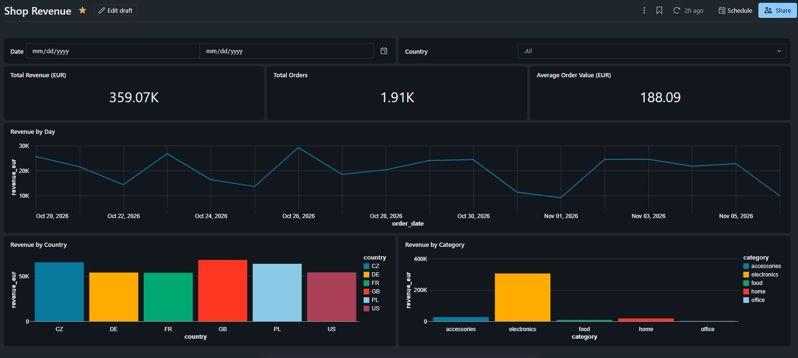
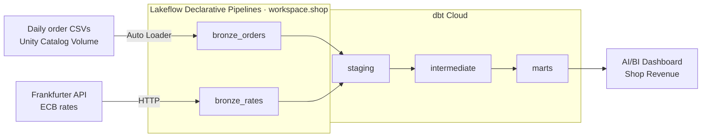
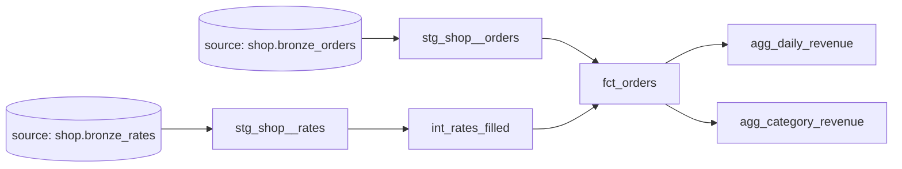
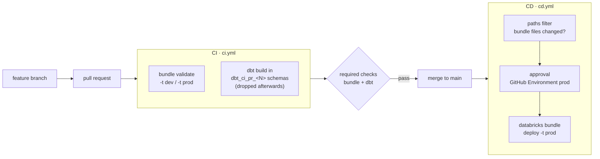

# shop-pipeline

End-to-end analytics pipeline on **Databricks** for an online shop. Daily order files (CSV, five currencies) and daily
European Central Bank exchange rates (Frankfurter API) are ingested, validated and combined into revenue reporting in EUR.
Ingestion is handled by **Lakeflow Declarative Pipelines**, all transformation logic lives in **dbt**, and the results
feed an AI/BI dashboard.



## Architecture

| Layer | Tool | Responsibility |
|---|---|---|
| Bronze | Lakeflow Declarative Pipelines | Ingestion only: Auto Loader for CSV files, HTTP API call for exchange rates. Raw data, all columns as strings, plus `source_file` / `ingested_at` |
| Staging → intermediate → marts | dbt (dbt Cloud) | Typing, deduplication, validation, currency conversion, revenue aggregates, tests |
| Reporting | Databricks AI/BI | Dashboard on the dbt marts |



## dbt lineage



| Model | Materialization | Description |
|---|---|---|
| `stg_shop__orders` | view | Typed orders, deduplicated by `order_id` (latest load wins), `is_valid` flag |
| `stg_shop__rates` | view | Typed ECB rates, inverted to `rate_to_eur` |
| `int_rates_filled` | view | Rate for every calendar day × currency, forward-filled over weekends and holidays |
| `fct_orders` | table | One row per valid order with amount converted to EUR |
| `agg_daily_revenue` | table | Paid orders and revenue (EUR) by day and country |
| `agg_category_revenue` | table | Paid orders and revenue (EUR) by product category |

## Key design decision: weekend and holiday orders

The ECB publishes reference rates on business days only, but the shop sells every day.

The first version of the pipeline (a Lakeflow gold layer) joined each order to the rate **on the exact order date** and
used a `FAIL UPDATE` expectation so that revenue would never be lost silently. That was safe but brittle: a single
Saturday order had no matching rate and stopped the whole pipeline.

In dbt this is solved in `int_rates_filled`:

1. Build a calendar from the first published rate date to `current_date()`.
2. Cross join it with all currencies to get one row per day × currency.
3. Left join the published rates and forward-fill the gaps with the last published rate
   (`last_value(rate_to_eur, true)` over the currency's history).
4. Add `EUR = 1.0` for every day.

Each row carries `is_filled` (the rate was carried forward) and `rate_published_date` (the day the rate actually comes
from), and `fct_orders` exposes `is_rate_filled`, so filled rates stay transparent. The safety guarantee is kept as a
test instead of a pipeline failure: `rate_to_eur` must be `not_null` in both `int_rates_filled` and `fct_orders`.

## Data quality

- **Staging keeps every row.** `stg_shop__orders` adds an `is_valid` flag (customer present, quantity > 0,
  unit price > 0); `fct_orders` filters on `is_valid`. Invalid rows stay inspectable instead of disappearing.
- **Generic tests:** `unique` / `not_null` on primary keys, `not_null` on required fields (`order_ts`, `currency`,
  `customer_id`, `rate_to_eur`), `accepted_values` on `currency` and `status`.
- **dbt_utils tests:** `unique_combination_of_columns` for composite keys (`rate_date` + `currency`,
  `order_date` + `country`), `accepted_range` for positive order amounts.
- **Singular test:** `assert_no_future_orders` fails if any order is dated after today.
- **Source freshness:** both bronze tables are checked on `ingested_at` (warn after 1 day, error after 2).
- **Bronze notebook:** `Bronze Data Quality Check` validates the raw layer in Databricks.

The sample files in `sample_data/` are synthetic and contain intentional issues (nulls, zero quantity, negative price,
duplicate orders) to exercise these rules.

## Environments and deployment

| Environment | Where | Schemas |
|---|---|---|
| Development | dbt Studio (dbt Cloud IDE) | Personal schema per developer `dbt_<username>_shop` → `dbt_<username>_shop_staging`, `_intermediate`, `_marts` |
| Production | dbt Cloud deployment job | `prod_shop_staging`, `prod_shop_intermediate`, `prod_shop_marts` |

Daily schedule (Europe/Prague), after ECB rates are published around 16:00 CET:

- **17:00** – Lakeflow Job `shop_daily` ingests new order files and rates into bronze.
- **17:30** – dbt Cloud production job runs `dbt source freshness`, then `dbt build` (models + tests) into `prod_shop_*`
  (`dbt deps` runs automatically).
- **18:00** – the AI/BI dashboard refreshes on the new marts.

Git workflow: `feature/*`, `docs/*`, `chore/*` branches → pull request → protected `main`
(PR required, no force pushes).

## CI/CD



- **CI** (`.github/workflows/ci.yml`) runs on every pull request. It validates the bundle for both targets and runs
  `dbt deps` + `dbt build` in an isolated schema `dbt_ci_pr_<N>`. Its derived `_staging` / `_intermediate` / `_marts`
  schemas are always dropped at the end, even if the build fails. The `bundle` and `dbt` checks are required to merge
  into `main`.
- **CD** (`.github/workflows/cd.yml`) runs after a merge to `main`, only when `databricks.yml`, `resources/`, `pipeline/`
  or the workflow itself changed, or when started manually. It waits for approval in the GitHub Environment `prod`
  (restricted to `main`), then runs `databricks bundle validate` and `deploy -t prod`. It never runs the pipeline; the
  daily schedule does.
- **Infrastructure as Code:** the Lakeflow pipeline and the `shop_daily` job are defined in `databricks.yml` and
  `resources/`, with two targets.
  - `dev`: prefixed resource names, paused schedule, a personal `dev_<user>_shop` schema.
  - `prod`: `workspace.shop`, 17:00 schedule.

  In prod the job is UI-locked, so every change goes through a pull request.
- **Secrets:** Databricks host, token and SQL warehouse path are stored as GitHub Actions secrets. They are never
  printed or written to disk. Nothing is deployed from a laptop.
- **Why dbt-databricks in CI:** dbt Cloud runs dbt Fusion, which is still in preview and installed via a script. CI uses
  a pinned `dbt-databricks` pip package for reproducible runs. The project YAML (e.g. test parameters under
  `arguments:`) is kept compatible with both.
- **Alerting:** `shop_daily` emails the owner on failure.

## How to run

1. One-time setup: run `setup/01_setup_schema.sql`, upload files from `sample_data/` to `/Volumes/workspace/shop/raw_files/`.
2. Load bronze: `databricks bundle deploy -t dev` and `databricks bundle run -t dev shop_daily` (prod is deployed by CD).
3. Run the dbt Cloud production job (`dbt source freshness` → `dbt build`) to build `prod_shop_*`.
4. Development: create a `feature/*` branch in dbt Studio and run `dbt build` into your personal `dbt_<username>_shop_*` schemas.

## Repository structure

```text
.github/workflows/
  ci.yml                           # PR checks: bundle validate + dbt build in a CI schema
  cd.yml                           # prod deploy of the bundle after merge (with approval)
databricks.yml                     # Databricks Asset Bundle: dev / prod targets
resources/                         # bundle resources: Lakeflow pipeline, shop_daily job
dbt/                               # dbt project (dbt Cloud project subdirectory)
  dbt_project.yml
  packages.yml                     # dbt_utils
  models/
    staging/shop/                  # sources + stg_shop__orders, stg_shop__rates
    intermediate/                  # int_rates_filled
    marts/finance/                 # fct_orders, agg_daily_revenue, agg_category_revenue
  tests/                           # singular tests (assert_no_future_orders)
pipeline/shop-pipeline/
  transformations/
    bronze_orders.py               # Auto Loader: CSV files -> bronze
    bronze_rates.py                # Frankfurter API -> bronze
  data_quality/
    Bronze Data Quality Check.ipynb
  dashboards/
    Shop Revenue.lvdash.json       # AI/BI dashboard on dbt marts
setup/
  01_setup_schema.sql              # schema and volume (run once)
sample_data/                       # synthetic daily order files
docs/
  dashboard.jpg
```

## Tech stack

| Area | Technology |
|---|---|
| Platform | Databricks (Free Edition), Unity Catalog, Delta Lake |
| Ingestion | Lakeflow Spark Declarative Pipelines, Auto Loader, PySpark |
| Transformation | dbt Cloud (dbt Studio, deployment jobs), dbt_utils, Databricks SQL |
| Orchestration | Lakeflow Jobs, dbt Cloud jobs |
| Reporting | Databricks AI/BI Dashboards |
| Version control | Git, GitHub (pull requests, protected `main`) |
| CI/CD and IaC | GitHub Actions, Databricks Asset Bundles, Databricks CLI |

## Roadmap

- Add the AI/BI dashboard to the Databricks Asset Bundle (the pipeline and the job are already managed there).
