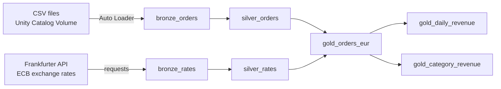

# shop-pipeline

End-to-end data pipeline on **Databricks** (Lakeflow Spark Declarative Pipelines) for an online shop:
daily order files and an exchange-rate API are ingested, cleaned and combined into revenue tables in EUR.
Built with a medallion architecture (bronze → silver → gold) and managed with Git / GitHub pull requests.

## Architecture



## Data sources

| Source | Description | Ingestion |
|---|---|---|
| Order files | Daily CSV files (`orders_YYYY-MM-DD.csv`) in 5 currencies: CZK, EUR, USD, GBP, PLN | Auto Loader (incremental, only new files) |
| [Frankfurter API](https://frankfurter.dev) | Daily reference exchange rates published by the European Central Bank | HTTP request, full refresh |

## Tables

| Layer | Table | Type | Description |
|---|---|---|---|
| Bronze | `bronze_orders` | Streaming table | Raw orders as received + `source_file`, `ingested_at` |
| Bronze | `bronze_rates` | Materialized view | Raw rates from the API (1 EUR = X currency) |
| Silver | `silver_orders` | Streaming table | Typed, deduplicated orders; invalid rows dropped |
| Silver | `silver_rates` | Materialized view | Rates converted to `rate_to_eur` + EUR = 1.0 |
| Gold | `gold_orders_eur` | Materialized view | Each order with amount converted to EUR |
| Gold | `gold_daily_revenue` | Materialized view | Orders and revenue (EUR) by date and country |
| Gold | `gold_category_revenue` | Materialized view | Orders and revenue (EUR) by product category |

## Data quality

- **silver_orders** – `expect_or_drop`: customer_id not null, quantity > 0, unit_price > 0; duplicates removed by `order_id`
- **silver_rates** – `expect_or_fail`: rate_to_eur > 0 (a wrong rate would corrupt all revenue)
- **gold_orders_eur** – `FAIL UPDATE` if an order has no matching exchange rate (revenue is never lost silently)
- Data quality check notebooks for each layer: row counts, duplicates, nulls, invalid values, bronze → silver reconciliation

## Repository structure

```text
setup/
  01_setup_schema.sql          # schema and volume (run once)
pipeline/shop-pipeline/
  transformations/
    bronze_orders.py
    bronze_rates.py
    silver_orders.py
    silver_rates.py
    gold.sql
  Bronze / Silver / Gold Data Quality Check   # validation notebooks
```

## How to run

1. Run `setup/01_setup_schema.sql` to create the `workspace.shop` schema and the `raw_files` volume
2. Upload order CSV files to `/Volumes/workspace/shop/raw_files/`
3. Create an ETL pipeline with root folder `pipeline/shop-pipeline` and default location `workspace.shop`
4. Run the pipeline; upload the next CSV and run again – only the new file is processed

## Development workflow

- Feature branches (`feature/silver`, `feature/api-rates`, `feature/gold`) → pull request → merge into `main`
- `main` is protected: pull request required, force pushes and deletion blocked

## Tech stack

Databricks (Free Edition) · Lakeflow Spark Declarative Pipelines · Auto Loader · Delta Lake · Unity Catalog · PySpark · SQL · Git / GitHub

## Next steps

- Schedule the pipeline with Lakeflow Jobs
- AI/BI dashboard on gold tables
- dbt models for the gold layer
- CI/CD with Databricks Asset Bundles and GitHub Actions
